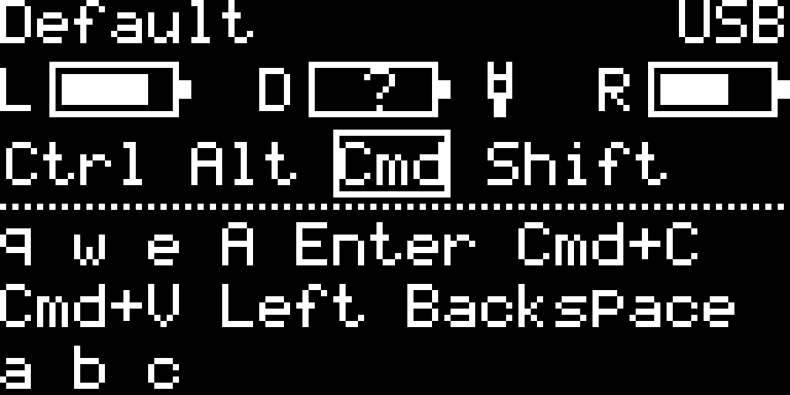

# Corne Silver

Одна раскладка, два комплекта прошивок ZMK:

- Обычный: правая половинка → левая половинка → компьютер
- С приёмником: обе половинки → отдельный приёмник → компьютер

Раскладка, слои, сочетания и макросы находятся только в `config/corne.keymap`

## Состояние проверки

Проверки сборки публикуются в [GitHub Actions](https://github.com/dzimin/zmk-corne/actions). Успешная сборка не подтверждает аппаратную совместимость

До первой прошивки приёмника требуется подтвердить совместимость с `nice_nano_v2`. Загрузчик сообщает `nice!nano` и `nRF52840-nicenano`, но не определяет ревизию платы

Экран, сопряжение трёх устройств, питание от конкретной зарядки, восстановление связи и возврат к исходной прошивке требуют проверки на устройствах. Эти проверки пока не выполнены

## Как получить прошивки

Открой успешный запуск Actions для нужной ветки или коммита и скачай архив `firmware` из раздела Artifacts. Все шесть файлов относятся к одному состоянию исходников

| Файл | Устройство и роль |
|---|---|
| `standalone-left.uf2` | Левая половинка, центральная в обычной схеме |
| `standalone-right.uf2` | Правая половинка, периферийная в обычной схеме |
| `dongle-central.uf2` | Приёмник, центральный для двух половинок |
| `dongle-left.uf2` | Левая половинка, периферийная для приёмника |
| `dongle-right.uf2` | Правая половинка, периферийная для приёмника |
| `settings-reset.uf2` | Сброс настроек контроллера `nice_nano_v2` |

Проверенные сборкой комплекты с контрольными суммами сохраняются в [GitHub Releases](https://github.com/dzimin/zmk-corne/releases). Для новых сборок до аппаратных проверок используй статус предварительного релиза и явно указывай статус проверки

Правые прошивки двух комплектов могут совпадать по содержимому: отдельные имена помогают выбрать согласованный комплект

## USB и Bluetooth

На центральном устройстве обеих схем включены:

```ini
CONFIG_ZMK_USB=y
CONFIG_ZMK_BLE=y
```

Используется штатный выбор выхода ZMK. После сброса настроек при одновременной готовности USB и Bluetooth предпочитается USB; если готов только один выход, используется он. Сохранённые ранее настройки выбора выхода могут влиять на приоритет

Приёмник можно питать от зарядки или внешнего аккумулятора и соединять с компьютером по Bluetooth. ZMK не всегда может определить, принимает ли другая сторона USB нажатия, поэтому работу от выбранного источника питания нужно проверить. Кнопки выбора USB/Bluetooth и дополнительная автоматика в эту раскладку не добавлены

При работе с приёмником периферийные половинки передают нажатия ему. Подключение половинки к компьютеру кабелем не заменяет приёмник

Подробнее: [выбор выхода](https://zmk.dev/docs/keymaps/behaviors/outputs), [приёмники ZMK](https://zmk.dev/docs/hardware-integration/dongle)

## Первое подключение приёмника и смена схемы

Перед изменением ролей скачай оба комплекта прошивок, файл сброса и исходный релиз восстановления. Убедись, что есть другой способ управления компьютером

1. Подтверди аппаратную совместимость приёмника с выбранной целью сборки
2. Выключи остальные части клавиатуры и переведи нужный контроллер в загрузчик аппаратной кнопкой Reset, как при обычной прошивке
3. Скопируй `settings-reset.uf2` на диск загрузчика, дождись перезапуска и снова войди в загрузчик
4. Скопируй рабочую прошивку для этого устройства и выбранного комплекта
5. Повтори сброс и прошивку для обеих половинок и приёмника при переходе на схему с приёмником; затем включи все три устройства рядом друг с другом
6. При беспроводном подключении компьютера выполни сопряжение с `Corne Silver RX`; для проводного подключи приёмник USB-кабелем с передачей данных
7. Проверь ввод с обеих половинок, слои, сочетания и экран, затем восстановление связи после перезапуска

Сброс удаляет сохранённые настройки и сопряжения. Старую запись клавиатуры на компьютере при необходимости нужно удалить и выполнить сопряжение заново. Обычная прошивка поверх старой сама по себе сопряжения не очищает

Не оставляй контроллер на `settings-reset.uf2`: после сброса требуется его рабочая прошивка. Загрузчик и его разделы не заменяются в рамках этого проекта

Смена «с приёмником / без приёмника» требует перепрошивки и сброса сопряжений. После обычного изменения раскладки роли и сопряжения менять не требуется; при неизменном протоколе достаточно обновить центральное устройство

## Bluetooth-профили

У приёмника шесть профилей компьютеров и других устройств: `0…5`. Два дополнительных места отведены половинкам, поэтому `BT_MAX_CONN` и `BT_MAX_PAIRED` равны 8

Удерживай Delete для слоя Fn. На нём сохранены:

- `N`, `M`, `,`, `.`, `/`, `\` — выбор профилей `0…5`
- Backspace — очистка сопряжения выбранного профиля

Сначала выбери свободный профиль, затем выполни сопряжение на компьютере. Настройки профилей хранятся на центральном устройстве: при обычной схеме — на левой половинке, при схеме с приёмником — на приёмнике

В обычном комплекте параметры Bluetooth сохранены исходными: штатно доступны профили `0…4`; существующая в раскладке кнопка профиля 5 дополнительный профиль сама не создаёт

## Экран и питание приёмника

| Настройка | Значение |
|---|---|
| Начальная цель сборки | `nice_nano_v2`, совместимость до прошивки подтверждается отдельно |
| Экран | SH1106, 128×64, I²C `0x3C` |
| SDA / SCL | P0.17 / P0.20 |
| Смещение сегментов | 2 пикселя |
| Имя Bluetooth | `Corne Silver RX` |

Экран белый на чёрном фоне, без кота. Шрифт 5×7 с ячейкой 6×8: название `Default` помещается целиком без прокрутки. Сверху показаны слой и выбранный выход (`USB` либо `BT0…BT5`; `?` рядом с профилем означает отсутствие соединения). Ниже расположены три аккумулятора `L / D / R`, строка модификаторов с рамкой вокруг активных и три строки истории нажатий. Буква `C` справа от модификаторов означает Caps Lock



Это результат отрисовки тем же кодом, который используется в прошивке; заряды на картинке условные, аккумулятор донгла пока обозначен `?`. [Согласованный визуальный эскиз](docs/dongle-screen-concept.png) служит ориентиром, а не точным снимком OLED

- Аккумуляторы изображены контуром со сплошным заполнением; при уровне до 20% включительно рядом появляется `!`
- `?` внутри аккумулятора — ещё нет достоверного показания; `x` — половинка не подключена
- Левая и правая половинки соответствуют источникам BLE 0 и 1, как у прежнего модуля; фактическое соответствие проверяется после сопряжения
- Вилка рядом с `D` означает наличие USB-питания, в том числе от зарядки; она не утверждает, что аккумулятор заряжается
- При USB-питании экран остаётся включённым независимо от выбранного выхода на компьютер
- Без USB экран гаснет через 30 секунд без нажатий; нажатие будит его и также передаётся в компьютер
- Подключение питания сразу включает экран; отключение запускает новые 30 секунд. Гашение не обрывает связь и не очищает ленту

История хранит последние 64 обработанных нажатия после разрешения слоёв, сочетаний и макросов. Буквы и знаки соответствуют английской раскладке, Shift и Caps Lock учитываются. Сочетания обозначаются как `Cmd+C`, служебные клавиши — `Enter`, `Backspace`, `Left`. Для Shift в сочетаниях используется `S+`; очень длинные сочетания сокращают Ctrl/Alt/Cmd до `C+/A+/G+`, чтобы обозначение целиком помещалось в строке. Backspace остаётся отдельным событием, отпускания и отдельные модификаторы в историю не входят. Неизвестные клавиши показываются кодом HID, медиа — названием либо `C…`

Лента показывает события прошивки, а не подтверждённый текст приложения: русская раскладка, Option, преобразования ОС и системный автоповтор могут давать другой результат. При перезапуске история очищается; при гашении сохраняется. Она не записывается во flash и не передаётся отдельным каналом

У донгла есть аккумулятор, но схема его измерения пока не подтверждена. Поэтому `D` показывает `?`, а автоматический опрос собственной батареи отключён только у приёмника через `CONFIG_ZMK_BATTERY_REPORTING=n`. Батареи половинок принимаются независимо через BLE BAS. В ZMK v0.2 определения событий обеих батарей собираются вместе с опросом собственной батареи: локальный shield отдельно подключает штатный `src/events/battery_state_changed.c`, когда опрос выключен. Это сохраняет события половинок без обращения к датчику донгла. Локальный экран различает ещё не полученное показание и настоящий ноль, а соединения проверяет раз в секунду

После проверки платы, схемы питания и выбранного `zmk,battery` датчика можно включить `CONFIG_CORNE_DONGLE_BATTERY_CONFIRMED=y` в профиле донгла. Тогда локальный экран опрашивает датчик напряжения раз в минуту, в том числе при простое от USB, и использует оценку уровня литиевого аккумулятора из ZMK v0.2. При ошибке датчика снова показывает `?`. Для датчиков, предоставляющих только готовый процент, этот путь нужно отдельно адаптировать. Сигнал контроллера зарядки не подтверждён, поэтому молния не выводится

Глубокий сон, программное выключение и управление внешним питанием отключены только у приёмника. Для гашения используется локальный таймер при `CONFIG_ZMK_DISPLAY_BLANK_ON_IDLE=n`; алгоритм не имитирует нажатия и не меняет штатный выбор USB/Bluetooth

Экран находится в локальном shield `corne_dongle_display`. Внешний `zmk-dongle-display` удалён из west; исходная версия, авторство и лицензия указаны в [THIRD_PARTY.md](boards/shields/corne_dongle_display/THIRD_PARTY.md). ZMK остаётся на `v0.2`

Логика питания, форматирование нажатий, быстрые макросы, кольцо истории и пиксели проверяются без устройств и SDK:

```sh
python3 tests/run_screen_tests.py
```

Для перегенерации точного превью добавь `--preview docs/dongle-screen.png`. Тесты используют AddressSanitizer и UndefinedBehaviorSanitizer; в CI выполняются отдельно от сборки прошивок

Оба преобразования матрицы и имена узлов физического расположения взяты из Corne ZMK `v0.2`. Профиль `config/corne_dongle.conf` переопределяет общие настройки только в сборке приёмника

## Возврат к исходному состоянию

Исходная точка до добавления приёмника:

- Коммит: `390fbc25b4e6bd9492558a2125c9812a5fbf78b4`
- Тег: `baseline-2026-10-23`
- [Релиз восстановления](https://github.com/dzimin/zmk-corne/releases/tag/baseline-2026-10-23)

### Восстановить устройства

Скачай исходный релиз и проверь контрольные суммы:

```sh
shasum -a 256 -c SHA256SUMS.txt
```

В исходном релизе сохранены оригинальные имена файлов:

| Файл | Назначение |
|---|---|
| `corne_left-nice_nano_v2-zmk.uf2` | Левая половинка, центральная |
| `corne_right-nice_nano_v2-zmk.uf2` | Правая половинка, периферийная |
| `settings_reset-nice_nano_v2-zmk.uf2` | Сброс настроек половинок |

Выключи приёмник. Поочерёдно сбрось настройки обеих половинок исходным файлом сброса и прошей каждую своим файлом из исходного релиза. Включи половинки, выполни сопряжение с `Corne Silver`, если используешь Bluetooth, и проверь ввод

Заводской дамп приёмника и контрольные суммы находятся локально в `backups/factory-dongle-2026-10-23/`. Он не публикуется в GitHub и служит дополнительной резервной копией; процедура восстановления из него пока не проверена

### Посмотреть или восстановить исходники

Исходники можно открыть в отдельной рабочей копии без изменения текущей ветки:

```sh
git fetch origin tag baseline-2026-10-23
git worktree add --detach ../zmk-corne-baseline baseline-2026-10-23
```

Для отмены уже опубликованного изменения в `master` создай ветку `codex/*` и новый коммит `git revert` для соответствующего изменения, затем pull request. Для merge-коммита отдельно укажи правильного основного родителя. Исходный тег не перемещай, историю не переписывай

Возврат исходников не меняет прошивку, настройки и сопряжения устройств. Готовые файлы исходного релиза сохраняются отдельно от временных артефактов Actions, чтобы восстановление не зависело от их срока хранения и будущего сборочного окружения

## Проверки на устройствах

Пункты ниже отмечаются только после фактической проверки:

- [ ] Подтверждена аппаратная совместимость приёмника с `nice_nano_v2`
- [ ] Обычный комплект сохраняет прежнее поведение
- [ ] В комплекте с приёмником работают все 42 клавиши и все слои
- [ ] Работают макросы, сочетания между половинками и модификаторы
- [ ] Работают USB, Bluetooth и все шесть профилей приёмника
- [ ] При питании от выбранной зарядки работает Bluetooth без выбора выхода
- [ ] При питании от выбранного внешнего аккумулятора работает Bluetooth без выбора выхода
- [ ] Экран правильно показывает слой, модификаторы, историю и батареи половинок
- [ ] Подтверждены схема измерения и показания аккумулятора донгла
- [ ] От USB экран не гаснет, включая простой при выходе по Bluetooth
- [ ] От аккумулятора экран гаснет через 30 секунд, первое нажатие будит экран и вводится
- [ ] Подключение и отключение питания правильно меняют режим экрана
- [ ] Связь восстанавливается после перезапуска каждого устройства
- [ ] Возврат половинок к исходному релизу проверен
